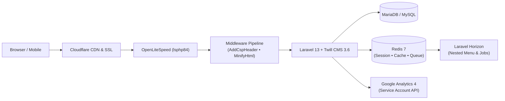

<div align="center">

<br/>


# Nusantara School CMS

**Enterprise Educational Portal & Modular Content Management Platform**

<p align="center">
  <a href="https://github.com/ze0expl01t/nusantara-school-cms/releases/tag/v1.0.0">
    
  </a>
  
  
  
  
  
</p>

<p align="center">
  Platform CMS modern berkecepatan tinggi untuk Sekolah, Madrasah, dan Institusi Vokasi.<br/>
  Dibangun dengan arsitektur modular <em>Block-Builder</em>, migrasi bersih anti-bentrok vendor, integrasi GA4, <em>Smart Backup</em>, dan pemindai keamanan otomatis.
</p>

<p align="center">
  <a href="#quick-start">Quick Start</a> •
  <a href="#tech-stack">Tech Stack</a> •
  <a href="#konfigurasi">Konfigurasi</a> •
  <a href="#reset-password">Reset Password</a> •
  <a href="#production-deploy">Production Deploy</a> •
  <a href="#troubleshooting">Troubleshooting</a> •
  <a href="https://smkmuh1blora.sch.id">Live Version</a>
</p>

</div>

---

##  Mengapa Nusantara School CMS?

<table>
  <tr>
    <td width="50%" valign="top">
      <h3> Modul Akademik & Jurusan Terpadu</h3>
      <p>Pengelolaan halaman profil sekolah, struktur organisasi, serta modul <strong>Kompetensi Keahlian / Jurusan</strong> (<code>/jurusan</code> & <code>/jurusan/{slug}</code>) lengkap dengan akreditasi, kepala jurusan, kurikulum, dan fasilitas.</p>
    </td>
    <td width="50%" valign="top">
      <h3> Twill Block Builder & Repeaters</h3>
      <p>Susun <em>landing page</em> secara visual tanpa menyentuh kode menggunakan blok modular (<code>hero</code>, <code>stat_2</code>, <code>milestone</code>, <code>contact</code>, <code>gallery</code>, <code>cta</code>) dan <em>Pure CSS Announcement Bar</em> (Zero-JS, anti-CSP block).</p>
    </td>
  </tr>
  <tr>
    <td width="50%" valign="top">
      <h3> Auto-Setup CLI & Clean Migration</h3>
      <p>Dilengkapi skrip <code>setup.php</code> dan pemisahan total <strong>47 tabel modul custom</strong> dari tabel vendor Twill CMS. Eksekusi <code>php artisan migrate:fresh --seed</code> berjalan mulus tanpa error <em>Table already exists</em>.</p>
    </td>
    <td width="50%" valign="top">
      <h3> Enterprise Security & Smart Backup</h3>
      <p>Dilengkapi header CSP ketat, sanitasi XSS (<code>safe_html</code>), pemindai kerentanan terjadwal (<code>checkpoint:scan</code>), serta kompresi backup cerdas yang mengecualikan <code>vendor/</code> dan <code>node_modules/</code>.</p>
    </td>
  </tr>
</table>

---

<a id="tech-stack"></a>
##  Arsitektur & Tech Stack



| Layer | Teknologi | Versi | Peran Utama |
| :--- | :--- | :--- | :--- |
| **Core Framework** | Laravel | `13.x` (`13.42+`) | Routing, Eloquent ORM, Scheduler, Security |
| **CMS Engine** | Twill CMS | `3.6.0` | Admin Panel, Media Library, Block Editor |
| **Runtime** | PHP (`lsphp84`) | `8.4.27+` | Eksekusi aplikasi performa tinggi |
| **Database** | MariaDB / MySQL | `10.6+` / `8.0+` | Penyimpanan relasional & tabel translasi |
| **Frontend UI** | Tailwind CSS + Alpine.js | `4.x` / `3.14` | Desain responsif modern & interaktivitas ringan |
| **Build Pipeline** | Vite + Node.js | `8.x` / `20.19+` | Bundling aset CSS/JS teroptimasi |
| **Queue & Cache** | Redis + Laravel Horizon | `7.x` / `5.50` | Background jobs, nested menu reorder, session |
| **Media Engine** | Image Proxy + Imagick | Latest | Konversi WebP/AVIF otomatis & *responsive crops* |

---

<a id="quick-start"></a>
##  Quick Start (Clone → Live)

Gunakan **CLI Auto-Installer (`setup.php`)** untuk menyiapkan seluruh dependensi, konfigurasi `.env`, *application key*, *storage symlink*, dan kompilasi aset frontend secara otomatis:

```bash
# 1. Clone repository
git clone [https://github.com/ze0expl01t/nusantara-school-cms.git](https://github.com/ze0expl01t/nusantara-school-cms.git)
cd nusantara-school-cms

# 2. Jalankan Auto-Installer CLI
php setup.php

# 3. Sesuaikan kredensial database, domain, dan Redis di .env
nano .env

# 4. Jalankan migrasi bersih (Vendor Twill + 47 Tabel Custom) & seeder data awal
php artisan migrate:fresh --seed

# 5. Buat akun Superadmin Twill CMS
php artisan twill:superadmin

# 6. Jalankan server lokal & queue worker
php artisan serve
```

> **Akses Aplikasi:**
> - **Portal Publik:** `http://127.0.0.1:8000`
> - **Panel Admin Twill:** `http://127.0.0.1:8000/panel-maintenance` *(sesuai `ADMIN_APP_PATH`)*
> - **Horizon Dashboard:** `http://127.0.0.1:8000/horizon`

---

<a id="konfigurasi"></a>
##  Konfigurasi Kritis (`.env`)

Pastikan parameter inti berikut terisi dengan benar pada file `.env` Anda:

```env
APP_NAME="Nusantara School CMS"
APP_ENV=local
APP_KEY=
APP_DEBUG=true
APP_URL=[http://127.0.0.1:8000](http://127.0.0.1:8000)
ADMIN_APP_PATH=backend

# LOCALE & BAHASA
APP_LOCALE=en
APP_FALLBACK_LOCALE=en
APP_FAKER_LOCALE=en_EN

# DATABASE
DB_CONNECTION=mysql
DB_HOST=127.0.0.1
DB_PORT=3306
DB_DATABASE=
DB_USERNAME=
DB_PASSWORD=

# REDIS & SESSION (Gunakan DB index berbeda jika 1 server berbagi banyak project)
SESSION_DRIVER=
SESSION_DOMAIN=
SESSION_SECURE_COOKIE=false

REDIS_HOST=127.0.0.1
REDIS_PASSWORD=null
REDIS_PORT=6379
REDIS_DB=2
REDIS_CACHE_DB=3

# QUEUE & HORIZON
QUEUE_CONNECTION=
HORIZON_PATH=
HORIZON_PREFIX=

# GOOGLE ANALYTICS 4 (Opsional)
ANALYTICS_PROPERTY_ID=
```

> [!IMPORTANT]
> **Aturan `HORIZON_PATH`:** Nilai `HORIZON_PATH` **wajib 1 level** (contoh: `HORIZON_PATH=horizon`). Jangan gunakan *nested path* seperti `panel-maintenance/horizon` karena akan bertabrakan dengan *catch-all route* modul admin Twill CMS.

---

<a id="reset-password"></a>
##  Reset Password Admin & User via Tinker

Setelah menjalankan `php artisan migrate:fresh --seed` menggunakan data snapshot (`LiveDatabaseSeeder`), seluruh password akun di database disanitasi demi keamanan. Gunakan **Laravel Tinker** melalui terminal untuk mengatur ulang password seluruh pengguna sekaligus atau akun tertentu:

### 1. Reset Password untuk Semua User (Twill Admin & Frontend Users)
```bash
php artisan tinker --execute='
$newPassword = \Illuminate\Support\Facades\Hash::make("PasswordBaruAnda123!");
$twillCount = \A17\Twill\Models\User::query()->update(["password" => $newPassword, "published" => 1]);
$appCount   = class_exists(\App\Models\User::class) ? \App\Models\User::query()->update(["password" => $newPassword]) : 0;
echo "Berhasil reset password untuk {$twillCount} Twill user dan {$appCount} App user." . PHP_EOL;
'
```

### 2. Reset Password untuk Satu User Tertentu (Berdasarkan Email)
```bash
php artisan tinker --execute='
$user = \A17\Twill\Models\User::where("email", "admin@sekolah.sch.id")->firstOrFail();
$user->password = \Illuminate\Support\Facades\Hash::make("PasswordBaruAnda123!");
$user->published = 1;
$user->save();
echo "Password untuk {$user->email} berhasil diperbarui!" . PHP_EOL;
'
```

### 3. Melihat Daftar Email Akun Twill Admin yang Terdaftar
```bash
php artisan tinker --execute='
\A17\Twill\Models\User::all(["id", "name", "email", "role", "published"])->each(fn($u) => print_r($u->toArray()));
'
```

> [!TIP]
> Gunakan kombinasi password minimal 12 karakter (huruf besar, huruf kecil, angka, dan simbol) sebelum melakukan deployment ke server produksi.

---

##  Integrasi Google Analytics 4 (GA4)

Dashboard analitik terintegrasi (`spatie/laravel-analytics`) menampilkan statistik pengunjung dan pelacakan klik unduhan brosur (`data-analytics`) langsung di panel admin:

<details>
<summary><strong>Klik untuk melihat langkah konfigurasi GA4 Service Account</strong></summary>

1. **Ambil Property ID GA4:**
   Buka **Google Analytics** → **Admin** → **Property Settings** → **Property Details**, lalu salin angka **Property ID** (contoh: `456789123`, *bukan* Measurement ID `G-XXXX`).
2. **Buat Service Account di Google Cloud:**
   - Buka [Google Cloud Console](https://console.cloud.google.com/), aktifkan **Google Analytics Data API**.
   - Masuk ke **IAM & Admin → Service Accounts** → buat akun baru, lalu buat key berformat **JSON**.
3. **Simpan Kredensial JSON:**
   Letakkan file JSON ke lokasi berikut *(sudah dikecualikan di `.gitignore`)*:
   ```text
   storage/app/analytics/service-account-credentials.json
   ```
4. **Berikan Akses Viewer di GA4:**
   Salin `client_email` dari file JSON, lalu tambahkan ke **Google Analytics → Admin → Property Access Management** dengan peran **Viewer**.
5. **Perbarui `.env`:**
   ```env
   ANALYTICS_PROPERTY_ID=456789123
   ```

</details>

---

##  Struktur Direktori

```text
nusantara-school-cms/
├── app/
│   ├── Console/Commands/       # Perintah Artisan kustom (Sitemap, DiagnoseMenuLink)
│   ├── Http/
│   │   ├── Controllers/        # Frontend & Twill Admin (Backup, CheckpointScan, Analytics, Login)
│   │   └── Middleware/         # AddCspHeader, MinifyHtml, CheckMaintenanceMode
│   ├── Models/                 # Model Eloquent & TwillModuleModel (Jurusan, Page, Post, Brosur, MenuLink)
│   ├── Providers/              # AppServiceProvider, HorizonServiceProvider
│   ├── Services/               # CheckpointScanService (Symfony Process safe execution)
│   └── Support/                # helpers.php (safe_html XSS sanitizer), twill_proxy.php
├── config/
│   ├── analytics.php           # Konfigurasi Google Analytics 4
│   ├── backup.php              # Smart Backup (dinamis per domain & exclude vendor/node_modules)
│   ├── horizon.php             # Konfigurasi Laravel Horizon
│   └── twill.php               # Konfigurasi modul, media crops, & navigasi admin
├── database/
│   ├── migrations/             # Migrasi 47 tabel modul custom + failed_jobs
│   └── seeders/                # DatabaseSeeder.php & LiveDatabaseSeeder.php
├── resources/views/
│   ├── site/                   # Template publik (jurusan-list, jurusan-detail, blocks/, layouts/)
│   └── twill/                  # Form admin Twill, custom blocks, repeaters, backup & security UI
├── routes/
│   ├── web.php                 # Routing frontend (/jurusan, /berita, /brosur, /{slug})
│   ├── twill.php               # Routing panel admin & custom CMS pages
│   └── console.php             # Scheduler harian (Sitemap, Smart Backup, Checkpoint Scan)
└── setup.php                   # CLI Auto-Installer pasca-git clone
```

---

<a id="production-deploy"></a>
##  Deployment Produksi (OpenLiteSpeed / CyberPanel)

1. **Konfigurasi Environment Produksi (`.env`):**
   ```env
   APP_ENV=production
   APP_DEBUG=false
   APP_URL=[https://domain-sekolah-anda.sch.id](https://domain-sekolah-anda.sch.id)
   SESSION_DOMAIN=domain-sekolah-anda.sch.id
   SESSION_SECURE_COOKIE=true
   ```

2. **Set Hak Akses & Kepemilikan Direktori:**
   ```bash
   chown -R <user>:<group> /path/to/nusantara
   chmod -R 755 /path/to/nusantara
   chmod -R 775 storage bootstrap/cache
   ```

3. **Build Assets & Cache Produksi:**
   ```bash
   composer install --no-dev --optimize-autoloader
   npm ci && npm run build
   php artisan storage:link
   php artisan config:cache
   php artisan route:cache
   php artisan view:cache
   ```

4. **Aktifkan Horizon & Cron Scheduler:**
   Pastikan `php artisan horizon` berjalan di bawah **Supervisor / systemd** (wajib untuk fitur *Drag-and-Drop Nested Menu*), lalu tambahkan cron job berikut:
   ```cron
   * * * * * cd /path/to/nusantara && /usr/local/lsws/lsphp84/bin/php artisan schedule:run >> /dev/null 2>&1
   ```
   | Waktu | Tugas Otomatis (`routes/console.php`) |
   | :--- | :--- |
   | `00:00` | Regenerasi `public/sitemap.xml` |
   | `02:00` | Eksekusi *Smart Backup* database & arsip aplikasi |
   | `03:00` | Pemindaian keamanan otomatis (`checkpoint:scan`) |

---

<a id="troubleshooting"></a>
##  Troubleshooting Cepat

| Gejala | Penyebab Utama | Solusi |
| :--- | :--- | :--- |
| **Urutan Drag-and-Drop Menu tidak tersimpan** | Queue Worker (Horizon) mati atau tabel `failed_jobs` tidak ada | Cek `php artisan horizon:status`, pastikan tabel `failed_jobs` tersedia, lalu jalankan `MenuLink::fixTree()` via Tinker. |
| **Halaman `/horizon` blank putih** | `MinifyHtml` memodifikasi inline JS Vue | Pastikan bypass `$request->is('horizon*')` dan batas `> 500 KB` aktif di `Middleware/MinifyHtml.php`. |
| **Media gambar Twill tidak tampil (404)** | Symlink `public/storage` terputus | Hapus symlink lama, jalankan `php artisan storage:link`, dan set `chmod -R 775 storage`. |
| **Tampilan tidak berubah setelah update** | Cache route/view/config belum dibersihkan | Jalankan `php artisan optimize:clear`. |

---

<div align="center">

<br/>

**Dikembangkan oleh Tim IT & Pengembangan Web — Arkan Intermedia**  
Didistribusikan di bawah lisensi **MIT License**.

</div>
<div align="center">
  <a href="https://saweria.co/arkanintermedia">
       
  </a>
</div>


